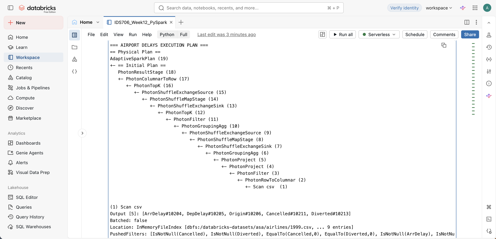
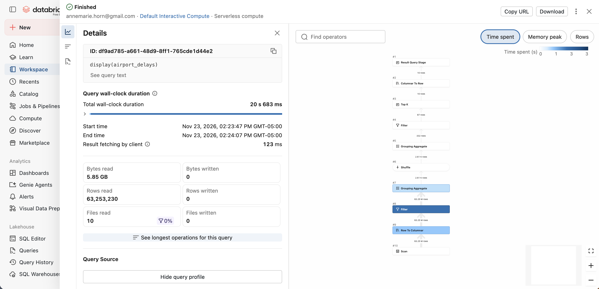
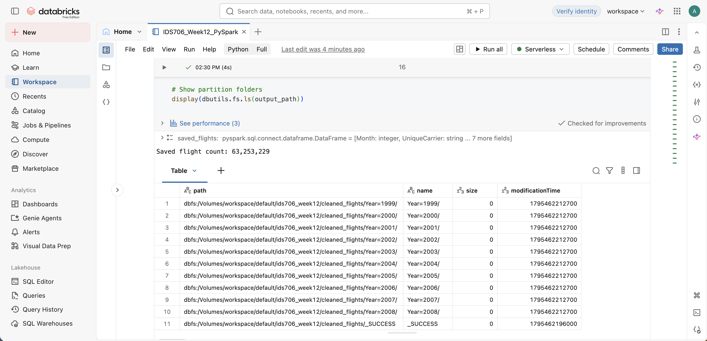
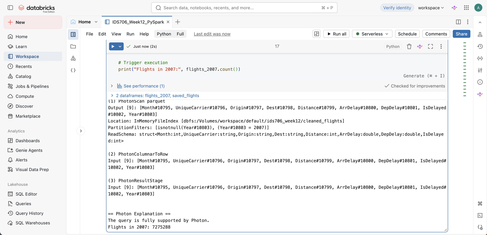
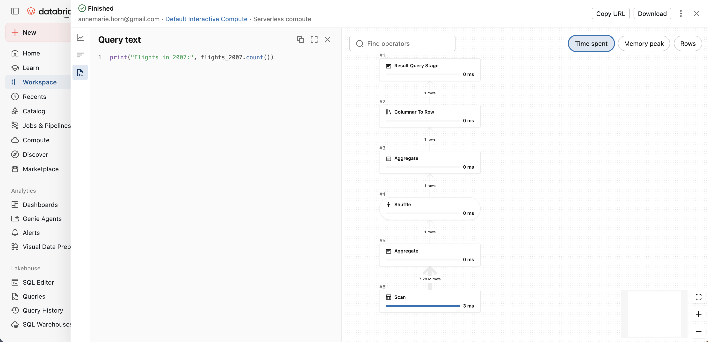

# Historical US Airline Flight Delay Analysis
### IDS 706 — Week 12 Mini Assignment: PySpark Data Processing

**Course:** IDS 706 — Data Engineering Systems  
**Date:** November 23, 2026  
**Environment:** Databricks, PySpark, Spark SQL, and Spark MLlib

## 1. Project Overview

This project implements a distributed PySpark data processing pipeline to analyze historical US airline flight delays from 1999 through 2008.

Using approximately 6.29 GB of source data containing more than 64 million flight records, the project demonstrates:

- Distributed data loading and processing with PySpark
- Data cleaning using multiple filtering operations
- Column transformations with `withColumn`
- Complex aggregations using `groupBy`
- Two Spark SQL queries
- Query optimization through early filtering, column pruning, and partitioning
- Physical execution plan inspection with `.explain()`
- Performance analysis using Databricks Query Details
- Lazy transformations versus eager actions
- Partitioned Parquet output
- A caching performance experiment
- Optional flight-delay prediction using Spark MLlib

The goal is to demonstrate how Spark processes large datasets efficiently while identifying historical airline delay patterns.

## 2. Dataset Description and Source

**Dataset:** Historical US Airline On-Time Performance Data (1999–2008)

**Source:** Databricks sample datasets

**Databricks directory:**
`/databricks-datasets/asa/airlines/`

The pipeline reads ten annual CSV files, covering 1999 through 2008.

| Dataset Property | Value |
|---|---|
| Source files | 10 CSV files |
| Total source size | Approximately 6.29 GB |
| Original records | 64,813,341 |
| Original columns | 29 |
| Cleaned records | 63,253,229 |
| Time period | 1999–2008 |

The dataset contains information about flight dates, airlines, origin and destination airports, flight distances, arrival and departure delays, cancellations, and diversions.

The dataset exceeds the assignment's 1 GB requirement and is suitable for demonstrating distributed data processing.

### Data Loading

The source files are loaded using `spark.read.csv()` with header detection and schema inference.

```python
flights = (
    spark.read
    .option("header", "true")
    .option("inferSchema", "true")
    .csv("/databricks-datasets/asa/airlines/{1999,200*}.csv")
)
```

## 3. Data Processing Pipeline

### Data Cleaning and Transformations

The pipeline performs the following operations:

1. Filters out cancelled flights (`Cancelled == 0`).
2. Filters out diverted flights (`Diverted == 0`).
3. Selects relevant columns to reduce unnecessary processing.
4. Converts arrival and departure delay columns to numeric values using `withColumn` and `try_cast`.
5. Filters out records with missing or invalid delay measurements.
6. Creates a binary `IsDelayed` column using `withColumn`, where a flight is considered delayed if its arrival delay exceeds 15 minutes.

The cleaned dataset contains **63,253,229 flight records**.

### DataFrame Aggregations

Two major grouped analyses are performed using `groupBy`:

**Airline Delay Analysis**

Groups records by `UniqueCarrier` and calculates:

- Total number of flights
- Average arrival delay
- Average departure delay
- Percentage of flights delayed
- Average flight distance

**Monthly Delay Analysis**

Groups records by `Month` and calculates:

- Total number of flights
- Average arrival delay
- Percentage of flights delayed

These operations demonstrate complex aggregation using distributed Spark DataFrames.

Because the necessary fields are contained in one dataset, grouped aggregations are used instead of an unnecessary join.

## 4. Spark SQL Queries

The cleaned DataFrame is registered as a temporary SQL view named `flights_clean_view`.

Two Spark SQL queries are executed.

### SQL Query 1: Airport Delay Analysis

The first query groups flights by departure airport and calculates:

- Total flight count
- Average arrival delay
- Percentage of flights delayed more than 15 minutes

The query uses `GROUP BY`, aggregation functions, `HAVING`, `ORDER BY`, and `LIMIT`.

It considers airports with at least 100,000 qualifying flights and identifies the ten airports with the highest delay rates.

**Key result:** JFK had the highest delay rate at 27.57%, followed by PHL at 27.18% and ORD at 26.98%.

### SQL Query 2: Yearly Delay Trends

The second query groups flights by year and calculates:

- Total flights
- Average arrival delay
- Average departure delay
- Percentage of delayed flights

The results identify changes in flight delays between 1999 and 2008.

**Key result:** 2007 had the highest delay rate at 23.84%, while 2003 had the lowest at 15.77%.

## 5. Query Optimization Strategies

The pipeline implements several optimization techniques.

### Early Filtering

Cancelled, diverted, and invalid records are filtered before the main aggregations. This reduces the number of records used in downstream processing.

### Column Pruning

Only necessary columns are selected. The physical execution plan shows that the airport-delay query reads five required columns instead of all 29 original columns.

### Filter Pushdown

The physical execution plan includes predicates for cancelled and diverted flights under `PushedFilters` at the CSV scan.

This allows filtering to be applied close to the data source. However, CSV does not provide the same columnar data-skipping advantages as Parquet.

### Partial Aggregation and Shuffle Reduction

Spark performs partial aggregation before redistributing data for the final grouped results.

This reduces intermediate data movement compared with shuffling all individual records.

The pipeline also avoids unnecessary joins because all required information is available in the original dataset.

### Partitioned Parquet Output

The cleaned data is saved as Parquet partitioned by `Year`.

This allows year-specific queries to avoid reading unrelated partitions.

### Partition Pruning

A query filtering for `Year = 2007` demonstrates partition pruning.

The physical execution plan includes:

```text
PartitionFilters: [isnotnull(Year), (Year = 2007)]
```

The query returns **7,275,288 records** for 2007.

This demonstrates that Spark recognizes the year partition and can restrict the scan to relevant data.

## 6. Performance Analysis

Spark's physical execution plan demonstrates filter pushdown, column pruning, and partial aggregation. Predicates excluding cancelled and diverted flights appear under `PushedFilters` at the CSV scan, along with null checks. Column pruning reduces the airport-delay query's required input from 29 columns to five. The plan also shows Databricks Photon operators and adaptive query execution. Partial aggregation reduces the amount of intermediate data that must be redistributed during grouped operations.

The Databricks Query Details view reported a **20.68-second execution time**, approximately **5.85 GB of data read**, and **63.25 million input rows** for the airport-delay query. The large CSV scan and shuffle required to group flights by departure airport are potential performance bottlenecks. To optimize the pipeline, filtering and column selection occur early, unnecessary joins are avoided, and Spark performs partial aggregation before shuffling. The cleaned dataset is written to Parquet partitioned by year, enabling partition pruning for year-specific queries. The 2007 query demonstrates this optimization, although a separate before-and-after runtime comparison was not performed.

Lazy evaluation was demonstrated by defining a filtering transformation in **0.0009 seconds**, while the subsequent `count()` action took **18.38 seconds**. The caching experiment showed that the second uncached aggregation took **0.46 seconds**, compared with **0.48 seconds** for the cached repeated run. Therefore, caching did not improve performance in this particular experiment. This may reflect the relatively small aggregated result, caching overhead, or runtime variability. The experiment demonstrates that caching is workload-dependent and should be benchmarked rather than assumed to accelerate every repeated operation.

## 7. Actions vs. Transformations

Spark distinguishes between transformations and actions.

**Transformations are lazy:** Operations such as `filter()`, `select()`, and `withColumn()` define a logical computation without immediately processing the entire dataset.

**Actions trigger execution:** Operations such as `count()`, `collect()`, and `show()` cause Spark to execute the computation.

The notebook demonstrates this difference by defining a filtering transformation and then executing `count()`.

### Measured Results

| Operation | Execution Time |
|---|---:|
| Define filtering transformation | 0.0009 seconds |
| Execute `count()` action | 18.38 seconds |

**Result:** 12,790,687 delayed flights.

Defining the transformation was nearly instantaneous because Spark did not execute the distributed computation until the action was called.

## 8. Caching Experiment

A repeated airline aggregation was evaluated with and without explicit caching.

| Operation | Execution Time |
|---|---:|
| First uncached aggregation | 0.76 seconds |
| Second uncached aggregation | 0.46 seconds |
| Cache materialization | 0.57 seconds |
| Cached repeated aggregation | 0.48 seconds |

The experiment used `.cache()` to persist the aggregated results and `.unpersist()` to release the cached data afterward.

Caching did not produce a measurable improvement in this test. The cached repeated action was slightly slower than the second uncached action.

This result illustrates that caching can introduce overhead and is most useful when the cost of recomputing data outweighs the cost of caching it.

## 9. Output Writing

The cleaned dataset is written to a Databricks Unity Catalog volume using Parquet format.

**Output path:**

```text
/Volumes/workspace/default/ids706_week12/cleaned_flights
```

The output is partitioned by `Year`, producing year-specific directories for 1999 through 2008.

The notebook verifies successful output writing by reading the saved Parquet files and confirming that the dataset contains **63,253,229 records**.

Parquet was selected because its columnar storage format is well suited for analytical queries, while year partitioning supports partition pruning.

## 10. Key Findings

### Monthly Flight Delay Patterns

- **December** had the highest delay rate at **25.32%**.
- **September** had the lowest delay rate at **15.19%**.
- **June** had the highest average arrival delay at **11.28 minutes**.

These results suggest that flight delays vary substantially by month.

### Airline Delay Patterns

- **EV** had the highest delay rate at **25.46%**.
- **HA** had the lowest delay rate at **6.12%**.
- **WN** had the highest flight count, with **10,012,218 flights**.

These comparisons reflect the historical dataset and do not account for differences in routes, operating conditions, or airline size.

### Airport Delay Patterns

Among departure airports with at least 100,000 qualifying flights:

| Airport | Delay Rate |
|---|---:|
| JFK | 27.57% |
| PHL | 27.18% |
| ORD | 26.98% |

### Yearly Delay Trends

- **2007:** Highest delay rate at **23.84%**
- **2003:** Lowest delay rate at **15.77%**

All delay rates are calculated as the percentage of qualifying flights arriving more than 15 minutes late.

These findings describe the historical 1999–2008 dataset and should not be interpreted as current airline performance.

## 11. Optional Machine Learning with Spark MLlib

An optional binary classification model was developed using Spark MLlib logistic regression to predict whether a flight would arrive more than 15 minutes late.

### Features

- Month
- Flight distance
- Airline
- Departure airport

Categorical variables were transformed using `StringIndexer` and `OneHotEncoder`, and features were assembled using `VectorAssembler`.

A reproducible sample of **189,189 flights** was divided into training and testing sets.

### Model Results

| Metric | Result |
|---|---:|
| Accuracy | 79.79% |
| ROC AUC | 0.5657 |
| Majority-class baseline accuracy | 79.79% |
| Accuracy improvement over baseline | 0.00 percentage points |

Although the model achieved approximately 79.79% accuracy, it did not outperform the majority-class baseline.

This illustrates the importance of evaluating classification models using metrics beyond accuracy, especially when the target classes are imbalanced.

## 12. Execution Plan and Databricks Screenshots

The following screenshots provide evidence of query optimization, successful pipeline execution, and partition pruning.

### Physical Execution Plan

The formatted physical execution plan generated using `.explain(mode="formatted")` shows the CSV scan, pushed filters, partial aggregations, shuffle, and final aggregation.



### Databricks Query Details

The Query Details view displays execution time, input data volume, and physical query operators for the airport-delay analysis.



### Successful Pipeline Execution

The pipeline successfully writes and reads the cleaned Parquet output, confirming the saved record count and year-partitioned directories.



### Partition Pruning

The physical execution plan confirms that Spark recognizes the `Year = 2007` partition filter.



### Additional Query Details

An additional Databricks Query Details screenshot provides supporting evidence of execution and query processing.



## 13. Repository Structure

```text
IDS706-Week12-PySpark/
├── README.md
├── IDS706_Week12_PySpark.ipynb
├── IDS706_Week12_PySpark.html
└── screenshots/
    ├── execution_plan.png
    ├── airport_query_details.png
    ├── successful_execution.png
    ├── partition_pruning.png
    └── query_details.png
```

## 14. How to Run the Notebook

1. Open `IDS706_Week12_PySpark.ipynb` in Databricks.
2. Attach a compatible Spark compute resource.
3. Confirm access to `/databricks-datasets/asa/airlines/`.
4. Run the notebook cells in order.
5. Review the DataFrame aggregations, Spark SQL results, and physical execution plan.
6. Inspect the Databricks Query Details view.
7. Verify the cleaned Parquet output in the Unity Catalog volume.

The notebook requires permissions to create and write to the specified Unity Catalog volume.

The accompanying HTML export allows the notebook and its saved results to be reviewed without executing the pipeline.

## 15. Conclusion

This project demonstrates a complete distributed data processing workflow using PySpark and Databricks.

By analyzing more than 64 million flight records, the pipeline applies filtering, transformations, grouped aggregations, Spark SQL, physical execution-plan inspection, and partitioned Parquet output.

The performance analysis illustrates how Spark uses filter pushdown, column pruning, partial aggregation, and partition pruning to optimize analytical workloads. The lazy evaluation and caching experiments further demonstrate important concepts in distributed data processing.

The project also identifies historical patterns in flight delays across airlines, airports, months, and years.
